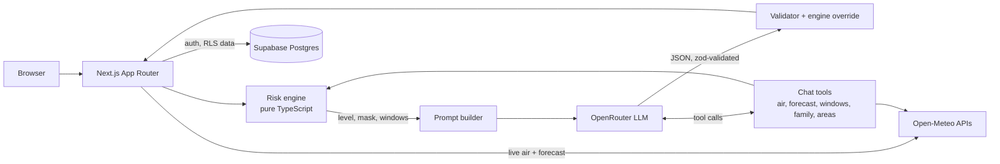

# Saans (سانس) — a smog health guardian for Lahore

Minhaj University Lahore AI Hackathon · **SDG 3: Good Health & Well-Being**

Saans turns live Lahore air quality into a **personal daily plan for each person at home**, in Urdu, Roman Urdu and English. A deterministic risk engine decides who is at risk and when; an AI model only writes the words. Saans is a health-awareness tool, **not** a medical device.

## Problem

Every winter Lahore's AQI regularly passes 200–400. A single city-wide number ("Unhealthy") hides the real question families ask: *is it safe for Ammi with asthma, for my brother who rides a bike for work, for my pregnant sister, for my 8-year-old walking to school?* Generic advice is ignored; people with the highest risk often get the least specific guidance.

## Target users

Households in Lahore, especially those with children, seniors, pregnant women, people with asthma/COPD/heart conditions, and outdoor workers (riders, rickshaw drivers). Language and reading level matter: plans are grade-5 reading level, in Urdu script, Roman Urdu or English, with a large-text mode and read-aloud.

## Solution & user journey

1. **Landing** shows live AQI for a Lahore area and how the same air affects a sample family differently.
2. **Sign in** with a magic link (or the one-click demo login), then **onboard** the household: area, and for each person age group, conditions, pregnancy, daily exposure and commute.
3. **Dashboard**: live AQI ring, PM2.5 vs the WHO guideline, 24h forecast with the best window, and a card per person with their own risk.
4. **Member plan** (`/member/[id]`): outdoor advice with best/avoid windows, mask, home, activity, health-watch signs, hydration, 1122 emergency routing, and a "why is my plan different?" box showing the engine's reasoning. Listen (speech), share on WhatsApp, regenerate.
5. **Compare** (`/compare`): the whole family side by side, plans generated in parallel from the same air.
6. **Puchho Saans** (`/chat`): a tool-using chat agent that answers from live data.
7. **Alerts**: a bell, toast and browser notification when risk reaches high now or within 6 hours.

## Architecture

All LLM calls happen in server route handlers; the API key never reaches the browser.

## Why hybrid

Language models are good at wording and bad at being a source of truth for health thresholds. So:

- The **risk engine** (`src/lib/risk/engine.ts`) is pure, unit-tested code. It multiplies the live AQI by a sensitivity factor built from age, conditions, pregnancy, exposure and commute, and maps the result to low / moderate / high / severe. It also picks mask type, best windows and risky windows, and decides whether to alert.
- The **LLM** only turns those facts into friendly, personal text. It never invents AQI numbers. If the model disagrees with the engine on risk level, mask or time windows, the engine's values overwrite the model's and the disagreement is logged.
- Every AI output is **zod-validated**; on failure we retry once with the error appended, then show a friendly error. We never fall back to fabricated content.

## Models & why

OpenRouter, default `google/gemini-2.5-flash` (`OPENROUTER_MODEL`, `OPENROUTER_CHAT_MODEL`): fast, cheap, handles Urdu and tool calling well. Plans use JSON mode; chat streams and runs up to 4 tool rounds. One gateway means the model can be swapped by changing an environment variable.

## Safety & ethics

- Footer disclaimer on every page: *Saans sehat ki aagahi ke liye hai, ilaaj ke liye nahi. Takleef ki soorat mein doctor se rujoo karein. Emergency: 1122.*
- The AI is instructed never to diagnose and never to change medication ("apni inhaler/dawai doctor ki hidayat ke mutabiq paas rakhein"); no food or remedy cure claims.
- Severe symptoms are routed to **1122**.
- Row-level security: a household's data is visible only to its owner. Service-role and OpenRouter keys are server-only. No secrets in the repo.
- The demo family is synthetic. Health details are used only to compute that household's plan.
- Limit of 30 AI answers per user per day. Cached plans (same person, area, AQI within ±20, under 60 minutes) are served without an AI call.
- Air data failures degrade gracefully: stale cached data is shown with a "cached" badge.

## Startup model

Free for families. Revenue from organisations that protect many people (schools, employers with outdoor staff, clinics, NGOs) via per-site subscriptions. See `/for-organizations` (roadmap teaser).

## Impact metrics

Success measures we would track in a pilot: households onboarded, share of high-risk members who receive a plan on high-AQI days, plans read/shared/listened, alert-to-action rate, and self-reported reduction in avoidable outdoor exposure. We make no clinical-outcome claims.

## Roadmap

Neighbourhood sensor blending, a WhatsApp bot, organisation dashboards, offline-first Urdu voice plans, and clinical review of the sensitivity factors.

## Tech stack

Next.js 16 (App Router, TypeScript strict), Tailwind CSS v4, Supabase (Auth, Postgres, RLS via `@supabase/ssr`), OpenRouter, zod, Recharts, lucide-react, Vitest. Air data: Open-Meteo Air Quality and Weather APIs. Fonts: Inter, Source Serif 4, Noto Nastaliq Urdu.

## Local setup

1. `npm install`
2. Copy `.env.example` to `.env.local` and fill it in.
3. Run `supabase/schema.sql` in the Supabase SQL editor.
4. In Supabase Auth, create a demo user (auto-confirmed) and put its credentials in `DEMO_EMAIL` / `DEMO_PASSWORD`.
5. `npm run dev`, open the app, press **Demo Login**, then **Demo family load karein** on onboarding.
6. `npm test` runs the unit tests (risk engine, plan validation/override/retry).

## Environment variables

`NEXT_PUBLIC_SUPABASE_URL`, `NEXT_PUBLIC_SUPABASE_ANON_KEY`, `SUPABASE_SERVICE_ROLE_KEY` (server-only), `OPENROUTER_API_KEY` (server-only), `OPENROUTER_MODEL`, `OPENROUTER_CHAT_MODEL`, `DEMO_EMAIL`, `DEMO_PASSWORD`. See `.env.example`.

## Team

Minhaj University Lahore AI Hackathon team: add names here.
